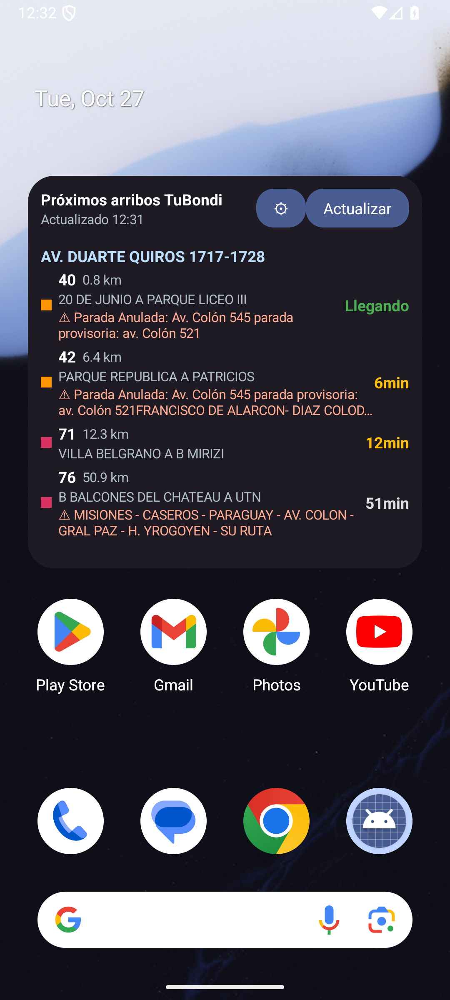
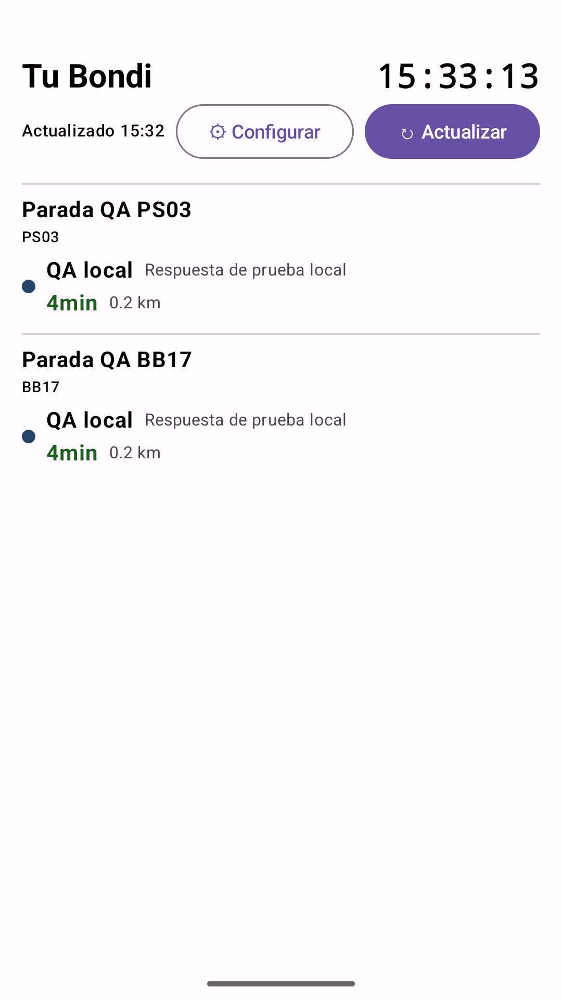
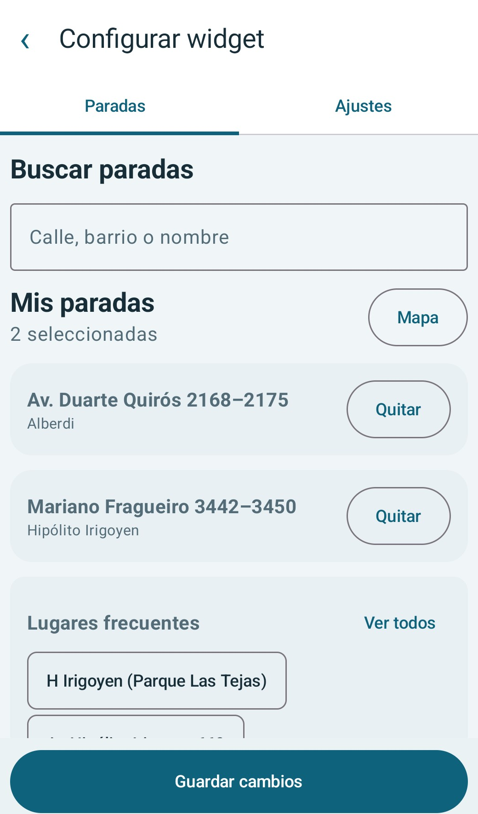

# Tu Bondi Widget

**Los próximos colectivos de Córdoba, directamente en tu pantalla de inicio.**

Elegí tus paradas y consultá arribos, destinos y avisos sin abrir el navegador. Cada widget tiene su propia configuración.

<p align="center">
  
  
</p>

<p align="center"><sub>Capturas reales del emulador Android; los arribos y avisos dependen del servicio.</sub></p>

## A mano cuando lo necesitás

- **Tus paradas.** Buscá por código, calle o barrio; si no aparece, ingresá el código exacto manualmente. Al elegir paradas por ruta podés filtrar líneas cuando están disponibles.
- **Información de un vistazo.** Consultá tiempo estimado, destino, distancia y avisos publicados por el servicio.
- **Más de un widget.** Configurá instancias independientes para distintas paradas.
- **Alertas opcionales.** Activá notificaciones de arribos próximos y definí el umbral de tiempo.
- **Sin conexión.** El buscador utiliza un catálogo incluido y el widget conserva todos los datos del último refresh exitoso si una actualización falla o supera su presupuesto; muestra el motivo y la hora de esos datos.
- **Estados y accesibilidad.** La actualización manual informa “Actualizando…”; si falla, tanto el widget como la pantalla completa retienen los arribos y la hora del último éxito y ofrecen reintentar. Alto contraste se aplica a ambas vistas y los controles exponen etiquetas y estados semánticos para lectores de pantalla.

## Primeros pasos

La app requiere **Android 8.0 (API 26) o superior**. Para compilar necesitás Android Studio, Android SDK 35 y JDK 17 o superior.

```bash
git clone https://github.com/LucioB16/Tu-Bondi-Tracker-Widget.git
cd Tu-Bondi-Tracker-Widget
./gradlew assembleDebug
```

En Windows usá `gradlew.bat assembleDebug`. El APK de depuración queda en `app/build/outputs/apk/debug/app-debug.apk`; instalalo desde Android Studio o con `adb install -r app/build/outputs/apk/debug/app-debug.apk`.

1. Mantené presionada la pantalla de inicio y agregá **TuBondi Widget** desde el selector de widgets.
2. Buscá una parada o agregá su código exacto manualmente; si elegís por ruta, podés seleccionar líneas específicas.
3. Ajustá la frecuencia automática (15–60 min) y las alertas, y tocá **Guardar**.
4. Usá **Actualizar** para pedir datos nuevos o tocá el encabezado para abrir la pantalla completa.

<p align="center"></p>

## Actualizaciones y notificaciones

El refresco manual consulta el servicio cuando lo solicitás. El refresco periódico usa WorkManager: Android establece un **mínimo de 15 minutos** y puede demorar la ejecución según batería y condiciones del dispositivo. La disponibilidad y la precisión de los arribos dependen de la API de TuBondi.

El selector permite recorrer todas las rutas disponibles. El catálogo de paradas está incluido en la app y no se actualiza automáticamente; existe una fuente municipal candidata, pero su antigüedad, equivalencia de códigos y condiciones de uso no están verificadas. Hasta entonces, podés ingresar manualmente el código exacto de una parada ausente; agregarlo no consulta el servicio. Las líneas y rutas se consultan al abrir la configuración, con un respaldo incluido.

En Android 13 o posterior, las notificaciones requieren permiso. Si lo denegás, podés habilitarlo desde los ajustes de Android. El canal permite silenciar los avisos durante una hora; la app evita repetir una alerta para la misma parada y línea durante diez minutos.

## Desarrollo

El widget está construido con Kotlin y Jetpack Glance; la configuración y la pantalla completa usan Compose. DataStore conserva la configuración por widget, WorkManager programa las actualizaciones y OkHttp consulta el servicio.

```bash
./gradlew testDebugUnitTest
```

Las pruebas unitarias usan fixtures y respuestas simuladas; no necesitan acceso a la API. Para ejecutar y verificar el widget completo, instalá el APK en un dispositivo o emulador y agregalo al launcher.

El build debug usa la URL HTTPS de producción por defecto. Para QA aislado, iniciá `python tools/mock_tubondi_api.py --mode success`, conectá el AVD con `adb reverse tcp:8765 tcp:8765` y compilá debug con `-PtubondiApiBaseUrl=http://127.0.0.1:8765`; el stub escucha exclusivamente en loopback. La variante release fija la URL HTTPS del servicio.

Los flows `c4-configure-*` parten de una instancia existente (ID 4 o 5) visible en launcher y abren su configuración mediante el control accesible `Configurar widget`. Antes de guardar en modo `success`, registrá `arrivals` y `responses408` con `Invoke-RestMethod 'http://127.0.0.1:8765/__control/stats'`; luego verificá que `arrivals` aumente y `responses408` no cambie antes de asumir que la caché quedó lista. Los contadores son acumulativos; para repetir QA no exijas `responses408=0` si ya se probó un error.

Para `*-408`, con la caché lista, fijá modo y demora con `Invoke-RestMethod 'http://127.0.0.1:8765/__control/mode?value=408'` y `Invoke-RestMethod 'http://127.0.0.1:8765/__control/delay?ms=8000'`; ejecutá `maestro test --udid emulator-5564 flows/c4-fullscreen-408.yaml flows/c4-launcher-408.yaml`; después restaurá `mode?value=success` y `delay?ms=0`.

La sesión de la API se mantiene en memoria mientras vive el proceso. Las preferencias se guardan localmente; al quitar una instancia se cancelan sus trabajos asociados y se purga su configuración sin afectar otros widgets. No se registran cookies en los logs HTTP configurados por defecto.

## Referencias

Basado en el comportamiento observado de [Tu-Bondi-Oma](https://github.com/LucioB16/Tu-Bondi-Oma) y en los datos de TuBondi. El acceso al servicio puede cambiar independientemente de esta app.

Licencia: consultá [LICENSE](LICENSE).
